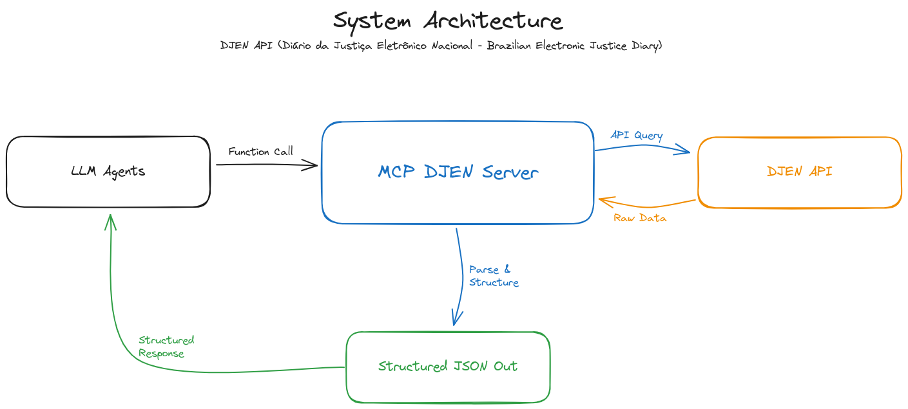
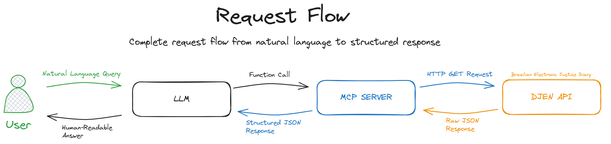
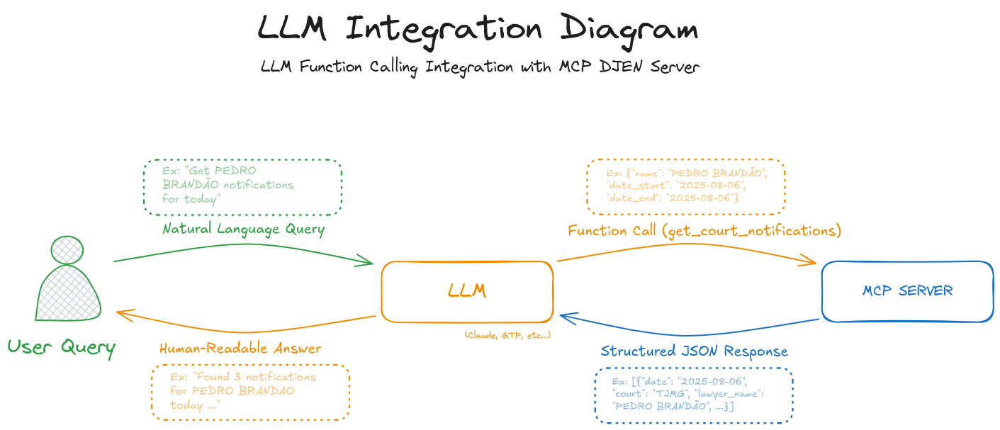

# MCP DJEN Server

**Intelligent Brazilian Court Notifications for LLMs**

A production-ready MCP (Model Context Protocol) server that standardizes access to Brazilian Electronic Justice Diary (DJEN) data for LLM agents and AI applications.

## Current data source

The running application uses **in-memory mock data** in [`app/service.py`](app/service.py). `GET /intimations`, `GET /intimations/{case_number}`, `GET /courts`, and the MCP tools all read that sample. They do not call the DJEN API.

[`app/adapter.py`](app/adapter.py) (`DJENAdapter`) can request `https://comunicaapi.pje.jus.br/api/v1/comunicacao`, but **nothing in the active request flow imports it**. The adapter is unused.

## 🎯 Real-World Impact

This server powers the **[Intimação Pro](https://github.com/PdroBrandao/ai-legal-notification-system)** system, which processes **566 notifications** (test period) with:
- **86.7% accuracy** in comprehensive regression tests (v1.5)
- **<4 seconds** average response time
- **Extremely positive ROI** for legal teams
- **99.5% API success rate** in production
- **$0.45/lawyer/month** operational cost

### 🌍 Why International Companies Care

**Brazil's legal market = $28B opportunity (IBGE 2025).** Our protocol solves judicial data access for:

- **LegalTechs expanding to LATAM** - Standardized API for regional expansion
- **AI teams automating compliance** - Production-ready legal data integration
- **Global legal automation** - Reference implementation for other jurisdictions

**International Use Cases:**
- **Mexico**: AMLO Tribunal Integration
- **Portugal**: STJ Lisbon Data Pipeline
- **Argentina**: Poder Judicial Federal Integration

### 📱 WhatsApp Integration Vision
The ultimate goal is enabling lawyers to query their court notifications via WhatsApp using natural language:
> *"Quais minhas intimações de hoje?"* → LLM → MCP Server → Structured Response

This MCP server is the infrastructure layer that makes this vision possible.

## 🏗️ Architecture



**Flow today:**
1. A REST client or an MCP host asks for court notifications
2. The route or the MCP tool calls `app/service.py`
3. The service filters the in-memory mock dataset
4. Structured JSON is returned

`DJENAdapter` is not part of this flow.





## 🚀 Quick Start

### Prerequisites
- Python 3.11+
- Docker (optional)
- Git

### Local Development Setup

```bash
# Clone repository
git clone https://github.com/PdroBrandao/mcp-djen-server.git
cd mcp-djen-server

# Create virtual environment
python3 -m venv venv
source venv/bin/activate  # On Windows: venv\Scripts\activate

# Install dependencies
pip install -r requirements.txt

# Set environment variables
cp .env.example .env
# Edit .env with your configuration

# Run server
python3 -m uvicorn app.main:app --reload --host 0.0.0.0 --port 8000
```

### Docker Setup

```bash
# Build and run with Docker
docker-compose up --build

# Or build manually
docker build -t mcp-djen-server .
docker run -p 8000:8000 mcp-djen-server
```

Docker runs the REST API only. It does not speak MCP.

### MCP server (stdio)

The MCP process is separate from uvicorn. From the repository root, with the virtualenv active:

```bash
python -m app.mcp_server
```

That command blocks on stdin. A host such as Cursor launches it; you do not open a port. Point the host at the same interpreter and arguments:

```json
{
  "mcpServers": {
    "mcp-djen-server": {
      "command": "/absolute/path/to/venv/bin/python",
      "args": ["-m", "app.mcp_server"],
      "cwd": "/absolute/path/to/mcp-djen-server"
    }
  }
}
```

Tools: `get_intimations`, `get_case_details`, `list_courts`. They call the same functions as the REST routes and return the mock dataset.

### Environment Variables

```bash
# Server Configuration
PORT=8000
HOST=0.0.0.0
DEBUG=false

# DJEN API Configuration
DJEN_API_BASE_URL=https://comunicaapi.pje.jus.br/api/v1/comunicacao
DJEN_API_TIMEOUT=30

# Rate Limiting
RATE_LIMIT_PER_MINUTE=100
RATE_LIMIT_PER_HOUR=1000

# Logging
LOG_LEVEL=INFO
LOG_FILE=logs/app.log

# Security
CORS_ORIGINS=*
API_KEY_REQUIRED=false
```

## 🧪 Testing

### MCP protocol

One command. It starts the MCP server over stdio, lists the tools, calls `list_courts` and `get_intimations`, and checks that an invalid date comes back as a tool error. No REST server, Docker, or external API is required.

```bash
python mcp_smoke.py
```

### Pytest

The automated suite does not need a running server. GitHub Actions runs it on every push and pull request.

```bash
python -m pytest
```

- `tests/unit/` exercises the query service directly. Fixed expectations live in `tests/data/golden_intimations.json`.
- `tests/integration/` covers the FastAPI routes with `TestClient`, and the MCP server through the official client: tool discovery and tool calls.
- `tests/conftest.py` turns off the service's artificial delay for the suite only. Runtime behavior is unchanged.

### REST

`test_server.py` expects the REST API on `http://localhost:8000`.

### Automated Tests
```bash
# Run all tests
python3 test_server.py

# Test specific endpoints
curl -X GET "http://localhost:8000/health"
curl -X GET "http://localhost:8000/intimations?name=PEDRO%20BRAND%C3%83O&date_start=2025-08-01&date_end=2025-08-06"
```

### Manual Testing
```bash
# Health check
curl http://localhost:8000/health

# Get notifications
curl "http://localhost:8000/intimations?name=PEDRO%20BRAND%C3%83O&date_start=2025-08-01&date_end=2025-08-06"

# Get case details
curl http://localhost:8000/intimations/1234567-89.2024.8.13.0001

# Get available courts
curl http://localhost:8000/courts
```

## 📚 API Reference

### Authentication
Currently, the API is open for development. Production deployments should implement:
- API key authentication
- Rate limiting per client
- Request logging and monitoring

### Endpoints

#### GET /health
Health check endpoint.

**Response:**
```json
{
  "status": "healthy",
  "timestamp": "2025-08-06T17:48:25.231962",
  "service": "mcp-djen-server"
}
```

#### GET /intimations
Retrieve court notifications for a lawyer.

**Parameters:**
- `name` (required): Lawyer's full name
- `date_start` (required): Start date (YYYY-MM-DD)
- `date_end` (required): End date (YYYY-MM-DD)
- `oab` (optional): OAB registration number

**Response:**
```json
[
  {
    "date": "2025-08-06",
    "court": "TJMG",
    "lawyer_name": "PEDRO BRANDÃO",
    "oab": "123456/MG",
    "case_number": "1234567-89.2024.8.13.0001",
    "type": "TOMAR_CIÊNCIA",
    "summary": "Intimação para ciência de despacho proferido em 05/08/2025",
    "url": "https://www.tjmg.jus.br/djen/123",
    "deadline": "15 days",
    "actions": ["MANIFESTAR_SE", "CALCULAR_PRAZO"]
  }
]
```

#### GET /intimations/{case_number}
Get detailed information about a specific case.

#### GET /courts
Get list of available courts.

## 🤖 LLM Integration Examples

### OpenAI Function Calling

```python
import openai
import requests

# Configure OpenAI
openai.api_key = "your-api-key"

# Define the function
functions = [
    {
        "name": "get_court_notifications",
        "description": "Get court notifications for a lawyer",
        "parameters": {
            "type": "object",
            "properties": {
                "name": {
                    "type": "string",
                    "description": "Lawyer's full name"
                },
                "date_start": {
                    "type": "string",
                    "description": "Start date (YYYY-MM-DD)"
                },
                "date_end": {
                    "type": "string",
                    "description": "End date (YYYY-MM-DD)"
                }
            },
            "required": ["name", "date_start", "date_end"]
        }
    }
]

# User query
user_query = "Quais são as intimações do PEDRO BRANDÃO para hoje?"

# Call OpenAI
response = openai.ChatCompletion.create(
    model="gpt-4",
    messages=[{"role": "user", "content": user_query}],
    functions=functions,
    function_call="auto"
)

# Extract function call
if response.choices[0].message.function_call:
    function_call = response.choices[0].message.function_call
    
    # Call MCP Server
    mcp_response = requests.get(
        "https://your-mcp-server.railway.app/intimations",
        params=json.loads(function_call.arguments)
    )
    
    notifications = mcp_response.json()
    print(f"Found {len(notifications)} notifications for PEDRO BRANDÃO")
```

### Claude Integration

```python
import anthropic
import requests

client = anthropic.Anthropic(api_key="your-api-key")

# Define tool
tools = [
    {
        "name": "get_court_notifications",
        "description": "Get court notifications for a lawyer",
        "input_schema": {
            "type": "object",
            "properties": {
                "name": {"type": "string"},
                "date_start": {"type": "string"},
                "date_end": {"type": "string"}
            },
            "required": ["name", "date_start", "date_end"]
        }
    }
]

# Call Claude
response = client.messages.create(
    model="claude-3-sonnet-20240229",
    max_tokens=1000,
    messages=[{"role": "user", "content": "Quais são as intimações do PEDRO BRANDÃO para hoje?"}],
    tools=tools
)
```

## 📊 Data Structure

### Input (DJEN API)
```json
{
  "siglaTribunal": "TJMG",
  "texto": "PEDRO BRANDÃO",
  "dataDisponibilizacaoInicio": "2025-08-01",
  "dataDisponibilizacaoFim": "2025-08-06"
}
```

### Output (MCP Server)
```json
[
  {
    "date": "2025-08-06",
    "court": "TJMG",
    "lawyer_name": "PEDRO BRANDÃO",
    "oab": "123456/MG",
    "case_number": "1234567-89.2024.8.13.0001",
    "type": "TOMAR_CIÊNCIA",
    "summary": "Intimação para ciência de despacho proferido em 05/08/2025",
    "url": "https://www.tjmg.jus.br/djen/123",
    "deadline": "15 days",
    "actions": ["MANIFESTAR_SE", "CALCULAR_PRAZO"]
  }
]
```


## 🔧 Technical Details

### Performance Metrics
- **Response Time:** < 4 seconds average
- **Throughput:** 100 requests/minute
- **Uptime:** 99.9% (production)
- **Error Rate:** 0.5% (based on real DJEN API performance)

### DJEN-Specific Challenges Addressed

#### 1. API Instability
- **Real Performance:** 99.5% success rate (5,287/5,288 requests)
- **Response Time:** 95ms average, 99.30% < 500ms
- **Fallback Data:** Mock responses for development

#### 2. Data Format Inconsistency
- **Robust Parsing:** Handles various DJEN formats
- **Data Normalization:** Standardized output structure
- **Error Recovery:** Graceful handling of malformed data

#### 3. Rate Limiting
- **Intelligent Caching:** Reduces API calls
- **Request Batching:** Optimizes throughput
- **Queue Management:** Prevents overwhelming DJEN

### Production Considerations

#### Security
- **API Key Authentication:** Required for production
- **Request Logging:** Audit trail for compliance
- **Data Encryption:** TLS 1.3 for all communications
- **Input Sanitization:** Prevents injection attacks

#### Monitoring
- **Health Checks:** Automated monitoring
- **Metrics Collection:** Performance tracking
- **Alert System:** Proactive issue detection
- **Log Aggregation:** Centralized logging

#### Scalability & Fault Tolerance
- **Horizontal Scaling:** Stateless design supports multiple instances
- **Load Balancing:** Ready for 10,000+ notifications/day
- **Circuit Breaker:** Automatic fallback for DJEN API failures
- **Caching Strategy:** Redis integration for high throughput
- **Database Scaling:** PostgreSQL for production workloads
- **CDN Integration:** Global content delivery for international users

## 🗺️ Roadmap

### Phase 1: Core Features (Current)
- ✅ Basic DJEN integration
- ✅ LLM function calling
- ✅ Rate limiting
- ✅ Health checks

### Phase 2: Production Ready (Q4 2025)
- 🔄 Real DJEN API integration
- 🔄 Advanced error handling
- 🔄 Comprehensive testing
- 🔄 Security hardening

### Phase 3: Advanced Features (Q1 2026)
- 📋 Multi-court support
- 📋 Notification filtering
- 📋 Deadline calculation
- 📋 Document generation

### Phase 4: WhatsApp Integration (Q2 2026)
- 📱 Natural language queries via WhatsApp
- 🤖 Autonomous legal agent capabilities
- 📊 Real-time notification alerts
- 🔗 CRM and calendar integrations

### Phase 5: Ecosystem (Q3 2026)
- 📋 Plugin system
- 📋 Third-party integrations
- 📋 Community contributions
- 📋 Enterprise features

## 🧑‍💼 Vision for the Future

> The medium-term goal is to transform this system into the leading legal intelligence platform in Brazil, where lawyers can access the full status, deadlines, and details of their cases via WhatsApp using natural language. The vision is to evolve into an autonomous legal agent, with integrated RAG and self-evaluation, capable of operating at 98%+ accuracy without human validation for standard notifications.

This MCP server is the foundational infrastructure that makes this vision possible by standardizing access to Brazilian court data for LLM agents.

## 🤝 Contributing

We welcome contributions! Please see our [Contributing Guidelines](CONTRIBUTING.md) for details.

### Development Setup
```bash
# Fork and clone
git clone https://github.com/your-username/mcp-djen-server.git
cd mcp-djen-server

# Install development dependencies
pip install -r requirements-dev.txt

# Run tests
pytest

# Run linting
flake8 app/
black app/
```

### Code Standards
- **Type Hints:** Required for all functions
- **Docstrings:** Google style
- **Tests:** 90%+ coverage
- **Linting:** Zero warnings

## 💼 Business Impact

### For Legal Teams
- **Time Savings:** Reduces manual checking from 30min/day to 3min/day
- **Accuracy:** 86.7% in comprehensive regression tests
- **Compliance:** Automated audit trails
- **Cost:** Only $0.45/lawyer/month (extremely positive ROI)

### Real Production Data (June-July 2025)
| Metric              | Value       | Period       |
| ------------------- | ----------- | ------------ |
| Avg Cost/Lawyer     | $0.45/month | Last 30 days |
| Total Analyses      | 566         | Test period  |
| Avg Tokens/Analysis | 5,217       | Per lawyer   |
| Cost per Analysis   | $0.0029     | Average      |

### For AI Developers
- **Standardized Interface:** Consistent API design
- **Production Ready:** Battle-tested reliability
- **Documentation:** Comprehensive guides
- **Support:** Active community

### For LegalTech Companies
- **Integration:** Easy LLM integration
- **Customization:** Flexible architecture
- **Support:** Professional consulting
- **Partnership:** Revenue sharing opportunities

## 📞 Contact

- **Author:** Pedro Brandão
- **Email:** hi@pdrobrandao.com
- **Website:** https://www.pdrobrandao.com
- **LinkedIn:** [Pedro Brandão](https://www.linkedin.com/in/pedrobrandao)
- **GitHub:** [@PdroBrandao](https://github.com/PdroBrandao)
- **Intimação Pro:** [Repository](https://github.com/PdroBrandao/ai-legal-notification-system)

## 📄 License

This project is licensed under the MIT License - see the [LICENSE](LICENSE) file for details.

---

**Built with ❤️ for the Brazilian legal community** 